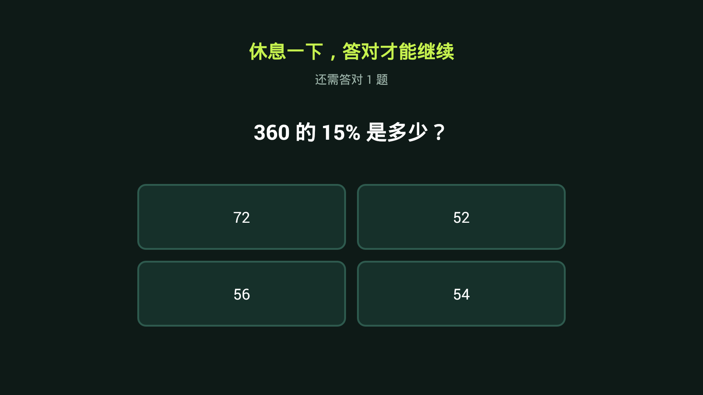
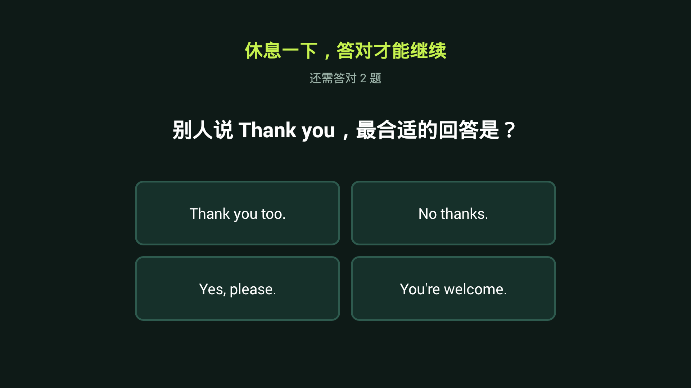

# QuizGate · 护眼小助手

一个给 Android 电视用的"思考门槛"：孩子看电视时，每隔几分钟自动弹出题目，**连对两题才能继续看**。

专为老旧设备设计——目标设备是 2016 年的夏普电视，Android 4.4.4，1GB 内存，无 root。

> 注：包名沿用早期的 `com.tvguard.tutor`，与项目名不一致。改名会导致已安装的设备上
> 出现两个独立应用，且需要重新录入设置，所以保留。





---

## English TL;DR

A lightweight Android TV app that interrupts viewing with a quiz every N minutes.
The user must answer 2 questions correctly in a row to dismiss it.
Written for Android 4.4.4 (API 19) and built **without Gradle** — plain `aapt` + `javac` + `d8` + `jarsigner`.
About 32 KB. No root required. Not a parental control tool — see [Limitations](#已知限制).

---

## 为什么做这个

起因是想去掉这台电视的开机广告，结果发现路走不通：

```
$ adb shell pm disable com.sharp.fxc.adservice
Killed                      # SIGKILL, 该组件 uid=system + PERSISTENT，带自保护
$ adb shell setprop persist.sys.poweronadvert 0
                            # 返回成功，但值不变——shell 无权写 persist 属性
$ adb shell pm disable com.yunos.tv.homeshell
Killed                      # 连默认桌面都不许换
```

广告去不掉，那就换个方向：**减少观看时间**。于是有了这个应用。

它做的事很简单——把"一直看下去"变成"看几分钟就要停下来动动脑"。

## 特性

- **三科轮转**：语文 / 英语 / 数学，每轮打乱顺序，保证均衡不偏科
- **题库**：数学用模板生成（无限题，背不下来），语文 75 题 + 英语 20 题（洗牌袋抽取，一轮内不重复）
- **防绕过**：返回键被吞、按 Home 键会被拉回
- **可调**：间隔 1/5/10/15/30 分钟，年级 1-6
- **开机自启**：注册 `BOOT_COMPLETED`，重启后自动恢复
- **极轻量**：32 KB，无第三方依赖，无网络权限

## 快速开始

> 直接下载：`dist/QuizGate-1.0.apk`（校验值见 `dist/SHA256SUMS`）
> 也可以按下方「编译」一节自行构建。

```bash
# 1. 连接电视（需先在开发者选项里开启网络调试）
adb connect <TV_IP>:5555

# 2. 安装
adb install -r QuizGate.apk

# 3. 启动并开始监控
adb shell am start -n com.tvguard.tutor/.MainActivity
```

然后点「开始监控」。设置界面会立刻关闭——这是刻意的，否则每次做完题会回到设置页而不是视频画面。

## 工作原理

### 为什么不用无障碍服务

常见做法是用 `AccessibilityService` 做全局窗口覆盖。但这里不需要：

**Android 4.4 没有后台启动 Activity 的限制**（那是 Android 10 才引入的）。
前台服务到点直接 `startActivity()` 就能弹出全屏界面，不需要任何特殊权限，也不需要用户去设置里开无障碍。

```
MonitorService (前台服务, 每 3 秒 tick)
    ├─ 屏幕亮着才累计时间
    ├─ 到点 → startActivity(QuizActivity)
    └─ 题目在显示中 → 每 3 秒复查焦点，被抢走就拉回
```

### 防绕过是怎么做的

| 手段 | 实现 | 效果 |
|---|---|---|
| 返回键 | 重写 `onBackPressed` / `onKeyDown` | 完全无效 |
| Home 键 | 服务每 3 秒检查 `QuizActivity.isForeground`，丢了就 `REORDER_TO_FRONT` 拉回 | 能离开约 3 秒，且不计入放行 |
| 界面被销毁 | `onDestroy` 里带节流地重建（800ms 内不重复触发） | 会重新出题 |
| 断电重启 | `BootReceiver` 恢复服务 | 计数从零开始 |

**为什么不用 Activity 自己恢复焦点**：实测发现视频 App（爱奇艺/优酷）会主动抢回前台，
单靠 `onPause` 里的 relaunch 两边会互相抢。所以把守护上移到 Service 层，用定时复查代替事件响应。

### 出题算法

**数学**：模板 + 参数随机化，不维护静态题库。干扰项按"常见错误类型"构造（差一 / 错一步 / 反向运算），
而不是随机数——随机数的干扰项一眼就能排除，等于没干扰。

**语文 / 英语**：知识表 + **洗牌袋**抽取。整表打乱依次取，取完再重洗。
这样保证一轮内绝不重复，比"避开上一次"的写法可靠得多（后者实测仍会重复）。

**科目轮转**：三科进队 → 打乱 → 依次出 → 出完再打乱。不是纯随机，纯随机会连续出好几道数学。

## 编译（不需要 Gradle）

这是本项目比较特别的部分。目标设备太老，用现在的 Android Studio 直接构建反而麻烦，
所以用了纯命令行工具链：

```
JDK 8   → 编译（-source 1.7 -bootclasspath android.jar）
JDK 17  → 运行 d8（build-tools 35 要求 JDK 11+）
build-tools 35 → aapt / d8 / zipalign
android-4.4.2  → android.jar
```

按以下结构放到 `build/toolchain/`（目录名固定，脚本按此查找）：

```
build/toolchain/
├── jdk8/           JDK 8（需要 javac）
├── jdk17/          JDK 17（需要 java，用来跑 d8）
├── build-tools/    Android build-tools 35（aapt / d8 / zipalign）
└── platform/       android-4.4.2（含 android.jar）
```

获取方式：

- JDK：[Adoptium Temurin](https://adoptium.net/) 8 与 17
- build-tools / platform：`sdkmanager`，或直接下
  `https://dl.google.com/android/repository/build-tools_r35_windows.zip`、
  `https://dl.google.com/android/repository/android-19_r04.zip`
  （国内可用 `https://mirrors.cloud.tencent.com/AndroidSDK/` 同名文件，快约 6 倍）

**为什么是两个 JDK**：Google 仓库里 build-tools 老版本已全部下架，只剩 r35/36/37，
它们要求 JDK 17；但 JDK 17 又不能配合 `android.jar` 做 bootclasspath 编译。所以只能分工。

先准备工具链目录（见下），然后：

```bash
export TVGUARD_KEYSTORE=/path/to/your.jks
export TVGUARD_KS_PASS=yourpassword
bash build/build.sh
```

签名文件不随仓库分发，需自己生成：

```bash
keytool -genkeypair -keystore tvguard.jks -alias tvguard \
  -keyalg RSA -keysize 2048 -validity 10950 \
  -storepass <PASSWORD> -keypass <PASSWORD> \
  -dname "CN=QuizGate, O=Home, C=CN"
```

脚本做六件事：

1. `aapt package` 生成 `R.java` + 资源包
2. `javac`（JDK 8）编译
3. `d8`（JDK 17 运行）转 `classes.dex`
4. `aapt add` 把 dex 打进 APK
5. `zipalign`
6. `jarsigner` 做 **v1 签名**（Android 4.4 只认 v1，v2/v3 不识别）

签名密钥需自备：

```bash
keytool -genkeypair -keystore tvguard.jks -alias tvguard \
  -keyalg RSA -keysize 2048 -validity 10950 \
  -storepass <PASSWORD> -keypass <PASSWORD> \
  -dname "CN=QuizGate, O=Home, C=CN"
```

## 测试

### 单元测试（不需要设备）

```bash
bash tests/unit/run_unit.sh 500 6
```

纯 JVM 跑题库。核心是用**独立求解器反算数学题答案**，与 `answerIndex` 指向的选项比对——
不是验证"能出题"，是验证"答案正确"。

覆盖项：选项数必须为 4、答案下标合法、选项不重复、题干/解析非空、
三科分布均衡、无连续重复、大批量不抛异常。

样例输出：

```
总题数      : 400
数学 / 语文 / 英语 : 133 / 146 / 121
数学已核验  : 133（无法解析 0）
连续重复    : 0
断言总数    : 4933
失败        : 0
RESULT: PASS
```

### 端到端测试（需要设备）

```bash
python tests/e2e/e2e_test.py
```

在真机上跑完整链路，8 项断言：

| 编号 | 验证点 |
|---|---|
| T1 | 默认配置正确（5 分钟 / 6 年级 / 三科）|
| T2 | 点开始监控后设置界面消失 |
| T3 | 到点自动弹出做题界面 |
| T4 | 返回键不退出做题界面 |
| T5 | 答对达标后自动放行 |
| T5b | 放行后回到之前看的画面，不回到设置界面 |

测试脚本会**从 `QuestionBank.java` 源码解析知识表**，所以能自动答对所有语文英语题，
不需要维护数据副本。

## 自定义

### 加题

编辑 `app/src/com/tvguard/tutor/QuestionBank.java` 里的 `CHINESE` / `ENGLISH` 数组，
每行 6 个字段：

```java
{"题干", "正确答案", "干扰项1", "干扰项2", "干扰项3", "解析"}
```

选项会自动打乱，不用关心顺序。改完重跑 `build/build.sh` 即可。

### 改默认值

`app/src/com/tvguard/tutor/Prefs.java`：

```java
getIntervalMin()  // 默认间隔，单位分钟
getGrade()        // 默认年级 1-6
getNeedCount()    // 需连对几题才放行（默认 2）
```

> 连对数不建议设 1。4 选 1 的蒙对率是 25%，连对 2 题降到 6.25%。

### 通过 adb 改配置

主界面支持 Intent 传参，适合脚本化或远程配置：

```bash
adb shell am start -n com.tvguard.tutor/.MainActivity \
  --ei tvguard.interval 5 \
  --ei tvguard.grade 6 \
  --ez tvguard.autostart true
```

## 已知限制

**这不是管控工具，是提醒工具。** 以下限制在 Android 4.4 无 root 的前提下无法解决：

| 限制 | 原因 |
|---|---|
| 系统设置里「强行停止」拦不住 | 需要 Device Owner，API 21 才有 |
| 卸载拦不住 | 同上 |
| 按 Home 能离开约 3 秒 | 做不到系统级拦截，只能抢回 |
| 开机后首次弹题时机不确定 | 开机加载占用了部分计时窗口 |

另外：

- 不保存错题历史，没有家长数据面板
- 题目每次重启重新生成
- **难度偏高会让工具从"提醒"变成"惩罚"**——如果孩子卡住，把连对数降到 1 或调低年级

## 兼容性

在 **夏普 LCD-45T45A**（Android 4.4.4 / Mstar M93J / 1GB RAM）上完整验证。

理论上适用于：

- Android 4.4 及以上、带网络调试的安卓电视 / 电视盒子
- 不依赖厂商定制 API，只用标准 Android 接口

需要注意：

- `targetSdkVersion` 写的是 19，因此在 Android 6.0+ 上会走旧版权限模型。
  如果要装到新设备，建议改成 21+ 并补上运行时权限申请
- 部分国产电视系统会限制开机自启，需要实测

## 踩坑记录

留给后来人，省点时间：

1. **`@android:drawable/sym_def_app_icon` 在 android-4.4.2 里不存在**，会报
   `attribute value reference does not exist`，必须自带图标文件。
2. **Android 4.4 只认 v1 (JAR) 签名**，用 `apksigner` 默认生成的 v2 签名它不识别，用 `jarsigner` 最稳。
3. **build-tools 老版本已从 Google 仓库下架**，只剩 r35+，全部要求 JDK 17。
4. **`d8.bat` 需要 `JAVA_HOME`**，只把 java 加进 PATH 不够。
5. **Activity 的 `android:exported`** 默认 false，会导致 `adb shell am start` 报
   `Permission Denial`，调试时容易被误导。
6. **`getRunningTasks()` 在 4.4 对第三方应用已受限**，判断前台应用不要指望它。
7. **Git Bash 调用 Windows 工具时路径会被转换**，`/c/foo` 会变成 `C:\c\foo`，
   要么设 `MSYS_NO_PATHCONV=1`，要么用 `sed` 转成 `C:/foo`。

## License

MIT —— 见 [LICENSE](LICENSE)。

题目内容（古诗、成语、历史地理常识）属公共知识；代码可自由使用、修改、分发。
